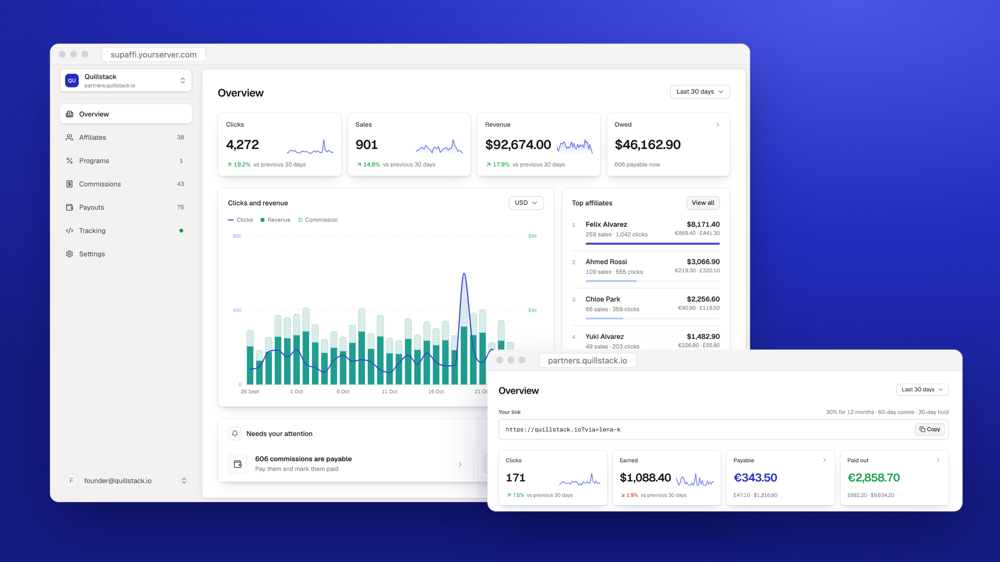

<p align="center">
  
</p>

<h1 align="center">Supaffi</h1>

<p align="center">
  Self-hosted affiliate programs for SaaS that sells through Stripe Checkout.<br>
  Your server, your Stripe account, no cut of your revenue.
</p>

<p align="center">
  <a href="https://github.com/ugolbck/supaffi/releases/latest"></a>
  <a href="./LICENSE"></a>
  <a href="https://github.com/ugolbck/supaffi/pkgs/container/supaffi"></a>
</p>

<p align="center">
  
</p>

Affiliates share a link to your site. Supaffi reads every sale and renewal from Stripe's webhooks, works out what each affiliate earned, and holds it until refunds have had time to land. You pay affiliates however you like and mark it paid.

One command installs it on a server you already rent. One install runs several products.

## Why founders run it

- **No revenue share.** Hosted affiliate tools charge by tier, and some take a percentage of what affiliates bring in. Supaffi costs the server it runs on.
- **Commissions match what Stripe collected.** Earned on the price after discounts and before tax. Credit balance, one-off charges, manual invoices and money paid outside Stripe earn nothing.
- **Refunds and chargebacks are handled before you pay.** A holding period keeps new commissions unpayable. A refund cancels or lowers the commission, an open dispute freezes it, a lost one cancels it.
- **Self-referrals get caught.** A sale is flagged when the buyer uses the affiliate's email or one of their cards. A flagged commission is never payable until you decide.
- **Your data stays on your server.** Stripe keys are encrypted at rest. Every image comes from this repository's release workflow, and you can verify that yourself.

## How it works

1. Install Supaffi and add your product with a restricted Stripe key. Supaffi creates its own webhook.
2. Add the script tag to your site and pass the referral into your Stripe Checkout Session.
3. Share your affiliate address. Commissions show up as sales come in, become payable after the holding period, and you pay them from the Payouts page.

## What it pays on

- One-time purchases and subscriptions through Stripe Checkout, including trials that convert and SEPA or ACH payments once they settle.
- A percentage per program, with a custom rate per affiliate. Paid once, for a set number of months, or for as long as the subscription pays.
- Renewals of the subscription the affiliate referred, including plan changes within the same Stripe product. Cancelling and coming back does not restart the clock.
- Last click wins, within an attribution window of up to 90 days.
- Each sale in its own currency. Nothing is converted.

It does not cover Payment Links, custom Elements checkouts, Paddle or Lemon Squeezy, Stripe Connect, sending the money itself, or tax forms. The full list of what it handles and what it doesn't is in [docs/what-supaffi-handles.md](docs/what-supaffi-handles.md).

## Install

On a fresh server (Docker is installed if missing):

```sh
curl -fsSL https://raw.githubusercontent.com/ugolbck/supaffi/main/install.sh | sudo bash
```

It prints an address and a token. Open the address, accept the self-signed certificate warning, paste the token, create your login. If the address doesn't load, open the port in your hosting provider's firewall.

## Add a product

1. Point an A record for `affiliates.yourproduct.com` at the server. On Cloudflare, proxy off (grey cloud).
2. Add the product in the dashboard with that hostname, your site's address and a Stripe key.
3. Paste the tracking snippet into your site, and pass the referral into your Checkout Session.

The hostname hosts the affiliate signup and their dashboard, so it must be on the product's own domain. One per product. Supaffi sends no email. If an affiliate forgets their password, you copy them a password link from their panel.

## Behind an existing reverse proxy

If ports 80 and 443 are taken, Supaffi leaves them alone. To switch modes later:

```sh
cd /opt/supaffi && sudo SUPAFFI_PROXY_MODE=external bash install.sh
```

Route each product hostname to the app and keep the `Host` header, which selects the product:

```nginx
location / {
    proxy_pass http://127.0.0.1:3000;
    proxy_set_header Host $host;
    proxy_set_header X-Forwarded-Proto $scheme;
}
```

A proxy running in a container can't reach the host's loopback. Share a network and forward to `http://supaffi-app-1:3000`:

```yaml
# docker-compose.override.yml
services:
  app:
    networks: [default, proxy]
networks:
  proxy:
    external: true
    name: your-proxy-network
```

## Options

| Variable | Effect |
| --- | --- |
| `SUPAFFI_DOMAIN=supaffi.example.com` | Serves the owner dashboard on a domain. Optional, the address keeps working. |
| `SUPAFFI_UPDATE_CHECK=off` | Stops the dashboard checking GitHub for new releases. |
| `SUPAFFI_BUILD_FROM_SOURCE=yes` | Builds the image on the server instead of pulling it. Needs about 2 GB of RAM. |
| `SUPAFFI_VERSION=x.y.z` | Installs that exact version. |

Pass them to the install command, e.g. `sudo SUPAFFI_DOMAIN=supaffi.example.com bash`.

## Update

```sh
cd /opt/supaffi && curl -fsSL https://raw.githubusercontent.com/ugolbck/supaffi/main/install.sh | sudo bash
```

Settings and secrets are kept. The database is backed up to `/opt/supaffi/backups` first, and the update stops if that fails. Migrations run on start. The dashboard tells you when a release is out but never updates itself. What changed in each release is in [CHANGELOG.md](CHANGELOG.md).

**Downgrading** moves the code back, not the database. The installer refuses unless you ask:

```sh
cd /opt/supaffi && sudo SUPAFFI_VERSION=0.1.0 SUPAFFI_ALLOW_DOWNGRADE=yes bash install.sh
```

If the release you're leaving changed the schema, restore the dump from `/opt/supaffi/backups`.

**Verify an image** was built by this repository's release workflow:

```sh
gh attestation verify oci://ghcr.io/ugolbck/supaffi:0.3.2 --repo ugolbck/supaffi
```

## Backups

The pre-update dump doesn't survive a dead disk. Keep, off the server:

- the database, on a cron: `docker compose exec -T db pg_dump -U supaffi supaffi | gzip > supaffi.sql.gz`
- `MASTER_ENCRYPTION_KEY` from `.env`, stored apart from the dump. It decrypts every Stripe key, so one stolen backup holding both gives up everything.

## Security

Report vulnerabilities as described in [SECURITY.md](SECURITY.md).

## Development

Next.js, Prisma, PostgreSQL. No Redis.

```sh
cp .env.example .env   # fill in the two generated secrets
cp docker-compose.override.yml.example docker-compose.override.yml
docker compose up -d db   # Postgres on 127.0.0.1:5432
npm install && npx prisma migrate deploy
npm run dev
```

Stripe won't call `localhost`. Forward webhooks with its CLI and paste the `whsec_` it prints into the connect form:

```sh
stripe listen --forward-to localhost:3000/api/webhooks/stripe
```

To fill a product's dashboards with demo affiliates, clicks and commissions, run `node prisma/seed-demo.mjs <product-slug>`. `--clear` removes them.

Tests run against `supaffi_test` and refuse any database whose name doesn't end in `_test`. Create it once with `createdb supaffi_test`, then migrate it with `DATABASE_URL` pointing at it.

## License

[AGPL-3.0](./LICENSE)
