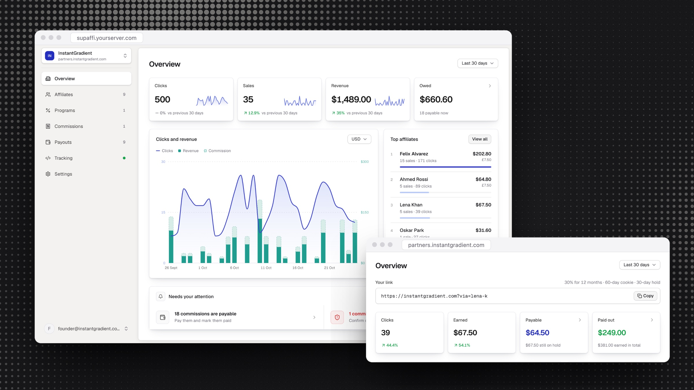

<p align="center">
  
</p>

<h1 align="center">Supaffi</h1>

<p align="center">
  <b>The simple, self-hostable affiliate software for SaaS.</b><br>
  One install runs a separate affiliate program for every app you own, and it never takes a cut.
</p>

<p align="center">
  <a href="#install">Install</a> · <a href="docs/what-supaffi-handles.md">What it handles</a> · <a href="CHANGELOG.md">Changelog</a>
</p>

<p align="center">
  <a href="https://github.com/ugolbck/supaffi/releases/latest"></a>
  <a href="./LICENSE"></a>
</p>

<p align="center">
  
</p>

Your affiliates share their link, Supaffi follows each sale and renewal through your payment provider, and you get a list of who to pay and how much.

## Features

- **Unlimited apps on one install**, each with its own affiliate program, domain, affiliates and payment account, fully separate from the others.
- **Recurring commissions** paid once, for a set number of months, or for as long as the customer keeps paying.
- **Several programs per app** for different tiers, plus a custom rate for any affiliate.
- **Refund-safe payouts**, because commissions wait out a holding period and an open chargeback freezes its commission until the dispute closes.
- **Self-referral detection** that holds back any sale made with the affiliate's own email or card.
- **An affiliate portal on your domain**, like `affiliates.yourapp.com`, where affiliates sign up and follow their earnings.
- **A payouts page** that lists who you owe and where to send it, with one click to mark them paid.

Stripe is supported today, and more payment providers are on the way.

## Install

On a fresh server (Docker is installed if missing):

```sh
curl -fsSL https://raw.githubusercontent.com/ugolbck/supaffi/main/install.sh | sudo bash
```

It prints an address and a token. Open the address, accept the self-signed certificate warning, paste the token, create your login. If the address doesn't load, open the port in your hosting provider's firewall.

## Add a product

1. Point an A record for `affiliates.yourproduct.com` at the server. On Cloudflare, proxy off (grey cloud).
2. Add the product in the dashboard with that hostname, your site's address and a Stripe key.
3. Paste the tracking snippet into your site. If you create Stripe Checkout Sessions yourself, pass the referral to Stripe when you create them. Payment Links, buy buttons and pricing tables need only the script.

The hostname hosts the affiliate signup and their dashboard, so it must be on the product's own domain. One per product. Supaffi sends no email. If an affiliate forgets their password, you copy them a password link from their panel.

## Behind an existing reverse proxy

If ports 80 and 443 are taken, Supaffi leaves them alone. To switch modes later:

```sh
cd /opt/supaffi && sudo SUPAFFI_PROXY_MODE=external bash install.sh
```

Route each product hostname to the app. Pass the `Host` header, which selects the product, and set the visitor's address yourself, replacing anything the visitor sent. Rate limits and the certificate check rely on these headers. Keep `/api/internal/` closed to outside visitors:

```nginx
location /api/internal/ {
    return 404;
}

location / {
    proxy_pass http://127.0.0.1:3000;
    proxy_set_header Host $host;
    proxy_set_header X-Forwarded-Host $host;
    proxy_set_header X-Forwarded-For $remote_addr;
    proxy_set_header X-Forwarded-Proto $scheme;
}
```

A proxy running in a container can't reach the host's loopback. Share a network and forward to `http://supaffi-app-1:3000`, with the same headers and the same closed `/api/internal/`:

```yaml
# docker-compose.override.yml
services:
  app:
    networks: [default, proxy]
networks:
  proxy:
    external: true
    name: your-proxy-network
```

## Options

| Variable | Effect |
| --- | --- |
| `SUPAFFI_DOMAIN=supaffi.example.com` | Serves the owner dashboard on a domain. Optional, the address keeps working. |
| `SUPAFFI_UPDATE_CHECK=off` | Stops the dashboard checking GitHub for new releases. |
| `SUPAFFI_BUILD_FROM_SOURCE=yes` | Builds the image on the server instead of pulling it. Needs about 2 GB of RAM. |
| `SUPAFFI_VERSION=x.y.z` | Installs that exact version. |

Pass them to the install command, e.g. `sudo SUPAFFI_DOMAIN=supaffi.example.com bash`.

## Update

```sh
cd /opt/supaffi && curl -fsSL https://raw.githubusercontent.com/ugolbck/supaffi/main/install.sh | sudo bash
```

Settings and secrets are kept. The database is backed up to `/opt/supaffi/backups` first, and the update stops if that fails. Migrations run on start. The dashboard tells you when a release is out but never updates itself. What changed in each release is in [CHANGELOG.md](CHANGELOG.md).

**Downgrading** moves the code back, not the database. The installer refuses unless you ask:

```sh
cd /opt/supaffi && sudo SUPAFFI_VERSION=0.1.0 SUPAFFI_ALLOW_DOWNGRADE=yes bash install.sh
```

If the release you're leaving changed the schema, restore the dump from `/opt/supaffi/backups`.

**Verify an image** was built by this repository's release workflow:

```sh
gh attestation verify oci://ghcr.io/ugolbck/supaffi:0.3.2 --repo ugolbck/supaffi
```

## Backups

The pre-update dump doesn't survive a dead disk. Keep, off the server:

- the database, on a cron: `docker compose exec -T db pg_dump -U supaffi supaffi | gzip > supaffi.sql.gz`
- `MASTER_ENCRYPTION_KEY` from `.env`, stored apart from the dump. It decrypts every Stripe key, so one stolen backup holding both gives up everything.

## Security

Report vulnerabilities as described in [SECURITY.md](SECURITY.md).

## Development

Next.js, Prisma, PostgreSQL. No Redis.

```sh
cp .env.example .env   # fill in the two generated secrets
cp docker-compose.override.yml.example docker-compose.override.yml
docker compose up -d db   # Postgres on 127.0.0.1:5432
npm install && npx prisma migrate deploy
npm run dev
```

Stripe won't call `localhost`. Forward webhooks with its CLI and paste the `whsec_` it prints into the connect form:

```sh
stripe listen --forward-to localhost:3000/api/webhooks/stripe
```

To fill a product's dashboards with demo affiliates, clicks and commissions, run `node prisma/seed-demo.mjs <product-slug>`. `--clear` removes them.

Tests run against `supaffi_test` and refuse any database whose name doesn't end in `_test`. Create it once with `createdb supaffi_test`, then migrate it with `DATABASE_URL` pointing at it.

## License

[AGPL-3.0](./LICENSE)
